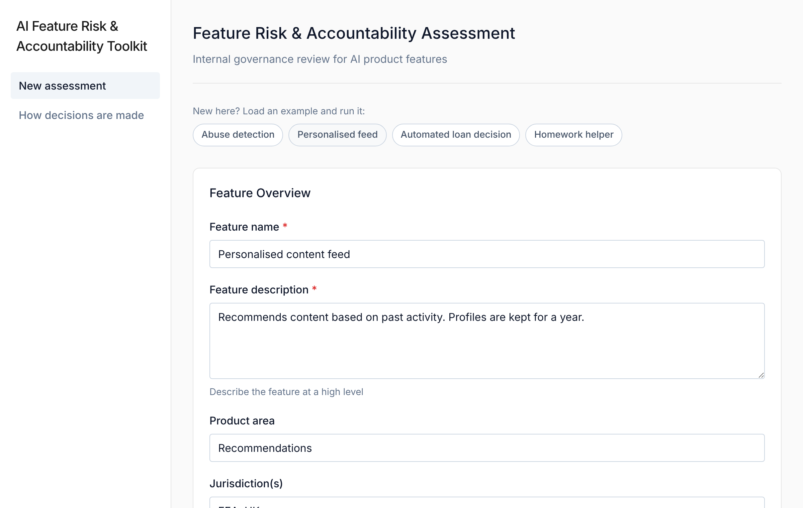
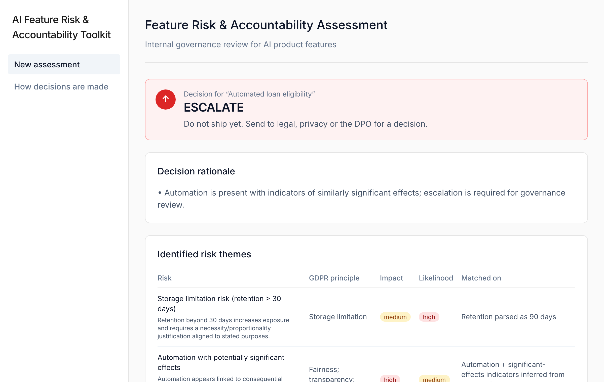
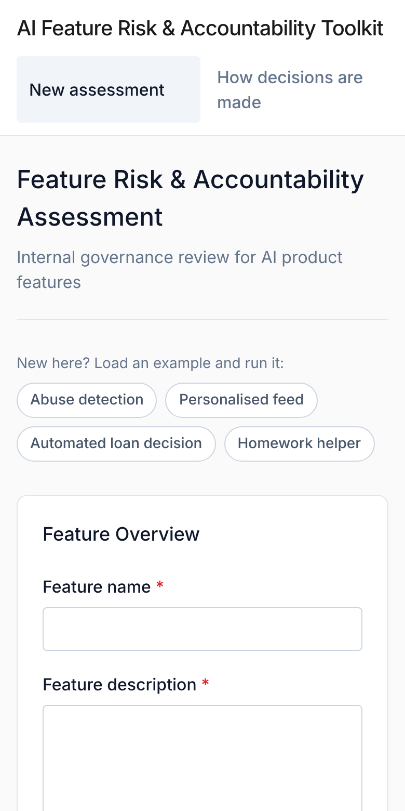

# AI Feature Risk & Accountability Toolkit

An experimental prototype exploring how AI feature-level governance decisions can be structured using deterministic, principle-based logic.

<p>
  
  
</p>

<p align="center">
  
</p>

---

## Overview

A small governance prototype that models how an AI-powered product feature could be reviewed before launch. You describe a feature (purpose, data categories, retention, automation, vendors, transfers) and the tool returns one of three gating outcomes with reasons:

- **SHIP**
- **SHIP WITH CONDITIONS**
- **ESCALATE**

It also returns the risks it matched, the conditions or follow-ups it expects, and a Markdown summary that a product, engineering or legal reviewer can read and challenge.

The backend uses deterministic rules. It does not use machine learning, does not interpret legislation and does not replace legal review or a DPO.

---

## Problem and intended user

These are working hypotheses, not validated findings.

- **Intended user:** a product manager or privacy reviewer at a company that ships AI features and has to decide, before launch, whether a feature needs a deeper privacy or legal review.
- **Problem:** reviews often start late, feature descriptions arrive incomplete, and there is no shared first-pass checklist. Product teams do not know which features need legal; reviewers spend time asking the same questions.
- **What the tool changes:** structured intake of the facts that matter, a consistent first-pass outcome with reasons, and a written record of assumptions and open questions that reviewers can challenge.
- **Not validated yet:** no user interviews have been done, and the thresholds are illustrative. A sensible next step is to test it with a handful of product managers and privacy reviewers and check how often its outcome matches their own judgment.

---

## Why deterministic, and why three outcomes

- **Explainable.** Every outcome comes with human-readable reasons, so a reviewer can see why the tool said what it said and disagree with it.
- **Predictable.** The same input always gives the same answer, which makes the logic testable (see `tests/`).
- **Three outcomes mirror a real review.** Ship, ship with safeguards, or send to people with the authority to decide. The tool does not try to be the decision-maker for the hard cases.

Escalation triggers in the current rules: children among data subjects; special category data (including proxies such as biometric or health data); automated decisions with indicators of significant effects. Everything else is SHIP or SHIP WITH CONDITIONS, depending on retention, purpose fit, matched risks and open conditions.

The 30-day retention threshold and the list of "acceptable" purposes are illustrative choices in the code, not legal requirements.

---

## How It Works

1. A feature description and structured inputs are submitted via the UI.
2. The FastAPI backend (`POST /assess`) applies rule-based checks (`backend/app/main.py`).
3. Risks are matched and scored against GDPR principles such as purpose limitation, storage limitation and transparency.
4. A gating decision, reasons and conditions are produced.
5. A Markdown summary is rendered: decision, feature overview, assumptions, decision rationale, conditions, identified risks and open questions or follow-ups.

If the backend is not reachable, the UI shows a clearly labelled warning that the result is a fixed demo sample and was not computed from the input.

The UI has four one-click examples (ship, conditions, two escalations) so a new user can see a result without filling in the form, a "How decisions are made" page, and a layout that works on phones.

---

## Tech Stack

- **Frontend:** React (Vite, TypeScript, Tailwind)
- **Backend:** FastAPI (Python), Pydantic schemas
- **Assessment logic:** deterministic rule engine in `backend/app/main.py`
- **Output:** structured JSON + Markdown summary

---

## Running Locally

### Backend

```bash
cd backend
python -m venv .venv
source .venv/bin/activate
pip install -r requirements.txt
uvicorn app.main:app --reload --port 8000
```

### Frontend

```bash
npm install
npm run dev
```

- Frontend: `http://localhost:5173`
- Backend: `http://localhost:8000` (health check: `/health`)
- Optional env var: `VITE_BACKEND_URL` (defaults to `http://localhost:8000`)

### Tests

From the repository root:

```bash
pip install -r backend/requirements.txt -r requirements-dev.txt
python -m pytest -q tests
```

The tests post each file in `sample_inputs/` to `/assess` and check the documented decision.

---

## Hosted demo (optional)

The frontend is static and the backend is a small FastAPI app, so a demo can be hosted for free:

1. **Backend:** deploy `backend/` as a web service (a `render.yaml` is included for Render). Set `ALLOWED_ORIGINS` to the frontend URL.
2. **Frontend:** deploy the repository root as a Vite site (Vercel, Netlify or Render static). Build command `npm run build`, output `dist`. Set `VITE_BACKEND_URL` to the backend URL.

Free tiers sleep when idle, so the first request after a pause can take about a minute.

---

## Purpose and Scope

This toolkit is not intended to replace formal legal review or DPO oversight. It is an internal support tool to:

- surface governance risks early in feature design,
- structure discussions between product, engineering and compliance teams,
- make assumptions and open questions explicit and reviewable.

---

## What the tool handles

- **Feature-level gating** with SHIP / SHIP WITH CONDITIONS / ESCALATE.
- **AI-specific risk patterns:** prompt and content logging, reuse of user content for model training, automated decision-making, vendor involvement, cross-border transfers.
- **Conditions and follow-ups** such as retention limits, transparency updates, vendor review or human oversight.
- **Explainability by design:** every decision lists its reasons.

---

## Project Structure

```
.
├── backend/
│   ├── app/main.py          # FastAPI app and the deterministic rule engine
│   └── requirements.txt
├── src/                     # React (Vite) UI, built from a Figma Make export
│   └── app/
│       ├── App.tsx
│       └── lib/             # API client, types, demo fallback
├── sample_inputs/           # Example feature descriptions (JSON)
├── tests/                   # Decision tests over the sample inputs
├── render.yaml              # Optional: backend deployment on Render
├── Guidelines.md            # Design principles for this project
└── README.md
```

---

## Limitations

- The rule engine is heuristic and simplified; rules and thresholds are hardcoded in one file.
- Inference from free text (training/reuse, significant effects) relies on keyword matching and can miss or over-trigger.
- It does not generate full DPIA, RoPA or legitimate-interest documents. It produces a short assessment summary only.
- It does not interpret legislation. Outputs are illustrative and are not compliance advice.

## Possible next steps

- Move rules, thresholds and risk descriptions into data files so legal reviewers can edit them without touching code.
- Add more test cases per rule, including edge cases for the keyword inference.
- Generate DPIA-style skeleton sections from the matched risks.
- Collect feedback from privacy and product reviewers on which outcomes they would change.

---

## Disclaimer

This project is a conceptual governance prototype. It does not provide legal advice and should not be used as a compliance tool. It does not replace formal legal analysis, DPO review or engagement with supervisory authorities where required.

---

## Why This Project Exists

AI governance discussions are often abstract. This prototype explores what it looks like when governance concepts are translated into code and workflow logic. It reflects an interest in the intersection of public policy, data protection law, AI governance, product design and system architecture.

---

## How it was built

Built with AI assistance (Claude, Anthropic) as a coding and drafting tool. The goal, the governance questions and the decision outcomes are the author's; the tests were run before publishing.

---

## License

MIT License
